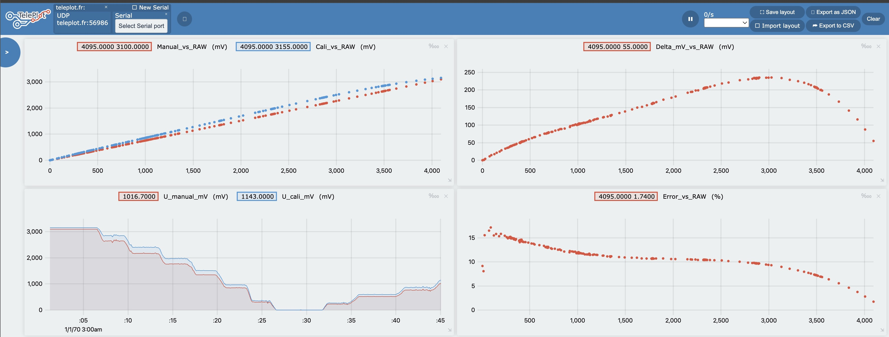

# Модуль 3, урок 2 (3.2) — Калібрування даних ADC

Потенціометр змінює напругу на ADC1. Кожні приблизно **100 мс** програма зчитує
один RAW-код і перетворює його на мілівольти двома способами: лінійною формулою
та калібруванням `esp_adc_cal`. У Serial виводяться обидві напруги та їхня
відносна розбіжність. Таблиця має чотири колонки з умови, а повідомлення
Teleplot паралельно будують графіки. Час вибірки передається як `t_ms`.

ESP32-S3 DevKitC-1; PlatformIO `espressif32@7.1.3`; Arduino-ESP32 2.0.17
з API ESP-IDF 4.4. Код навмисно використовує `driver/adc.h` та `esp_adc_cal.h`
із уроку. Для Arduino-ESP32 3.x / ESP-IDF 5.x потрібна міграція API.

## Підключення

Використайте потенціометр приблизно **10 кОм** як подільник напруги:

```text
3.3V ── крайній контакт потенціометра
                    │
                 [ 10 кОм ]
                    ├── повзунок (середній контакт) ── GPIO4 (ADC1_CH3)
                    │                                  │
GND ─── крайній контакт                               100 нФ (опційно)
                                                       │
                                                      GND
```

Крайні контакти підключіть до 3.3V і GND; повзунок — до GPIO4.
Усі землі спільні. Перестановка крайніх контактів змінює напрям регулювання.
На ADC не подавайте 5 V. Для цього досліду від'єднайте від GPIO4 кнопку
зі світлофора попереднього модуля. Прошивання замінить програму на платі.

Живлення подільника 3.3 V не означає, що АЦП лінійно вимірює весь цей діапазон:
біля верхнього положення можливе насичення. Основні вимірювання робіть
приблизно від 0.2 до 3.0 V, а крайні положення перевірте окремо.

## Параметри та формули

| Параметр | Значення |
| --- | --- |
| Вхід | GPIO4 = ADC1_CHANNEL_3 на ESP32-S3 |
| Розрядність | 12 біт; 4096 рівнів; максимальний код 4095 |
| Внутрішня номінальна Vref | 1100 мВ; це не живлення 3.3 V |
| Атенюація | `ADC_ATTEN_DB_12` (колишня назва — 11 dB) |
| Vmax для ручної моделі | 3100 мВ для цієї атенюації на S3 |
| Номінальний крок ручної моделі | 3100 / 4095 ≈ 0.757 мВ/код |
| Калібрування | eFuse `ESP_ADC_CAL_VAL_EFUSE_TP_FIT` |
| Інтервал | приблизно 100 мс; один зразок на рядок |
| Serial | 115200 бод, через USB–UART міст плати |

```text
U_manual(mV) = RAW × Vmax / (2^12 − 1) = RAW × 3100.0 / 4095
U_cali(mV)   = esp_adc_cal_raw_to_voltage(RAW, &adcCharacteristics)
Error(%)     = |U_manual − U_cali| / U_cali × 100
```

Для RAW=2048 ручна модель дає приблизно 1550.4 мВ. Каліброване значення
залежить від eFuse конкретного чипа. Обидва перетворення використовують **той самий
зразок**, без повторного читання між ними. При `U_cali=0` друкується `N/A`,
оскільки відносна похибка не визначена. RAW=0 або 4095 — граничні коди:
за ними неможливо визначити напругу поза діапазоном. У попередньому
журналі вимірювань ці рядки додатково позначені `EDGE`.

Vmax — наближений масштаб ручної моделі, який враховує атенюацію.
Множення лише на 1100 мВ не враховувало б її; підстановка 3300 мВ плутала б
живлення з діапазоном ADC. Параметр `default_vref=1100` передається у
`esp_adc_cal_characterize()` для відповідності сигнатурі; реалізація S3 його
ігнорує і використовує eFuse. Якщо потрібного калібрування немає, програма
виведе помилку та припинить вимірювання.

`Error` порівнює дві моделі перетворення, а не визначає абсолютну точність
відносно фізичного еталона. Для оцінки точності й нелінійності вимірюйте
напругу між повзунком і GND також мультиметром. Округлення до 0.1 мВ у ручній
колонці не означає такої точності АЦП.

## Збирання і прошивання

З кореня репозиторію (якщо `pio` немає в PATH, використайте
`~/.platformio/penv/bin/pio`):

```sh
pio run -d module3/lesson2 -e esp32-s3
pio device list
pio run -d module3/lesson2 -e esp32-s3 -t upload --upload-port /dev/cu.YOUR_BOARD
pio device monitor --port /dev/cu.YOUR_BOARD --baud 115200
```

Замініть `/dev/cu.YOUR_BOARD` на порт своєї плати. Використайте роз'єм
із USB–UART мостом (CH340/CH343/CP210x тощо). Якщо працюєте через нативний USB
ESP32-S3, змініть `ARDUINO_USB_CDC_ON_BOOT` у `platformio.ini` на `1` і
після прошивання повторно перевірте порт. Натисніть RESET після відкриття
монітора, щоб побачити параметри; надсилання `h` також повторює заголовок.

Приклад фактичного виводу з підключеної плати (вибрані рядки):

```text
 RAW  U_manual(mV)  U_cali(mV)  Error(%)
------------------------------------------
1023         774.4         878     11.80
1567        1186.3        1331     10.88
2023        1531.5        1713     10.60
2577        1950.8        2172     10.18
3027        2291.5        2527      9.32
```

Прошивання та запуск на фізичній платі перевірено; записано 439 зразків.
[Повний журнал, CSV та результати перевірки](results/README.md).

## Збір результатів для здачі

1. Відкрийте монітор із записом: `pio device monitor --port /dev/cu.YOUR_BOARD --baud 115200 --filter log2file`.
2. Натисніть RESET і перевірте, що виведено калібрування `eFuse TP_FIT`.
3. Зупиняйте потенціометр у 5–10 положеннях по всьому діапазону на 1–2 секунди;
   окремо перевірте мінімум і максимум. За можливості запишіть покази мультиметра.
4. Завершіть монітор через Ctrl+C. Шлях до створеного журналу покаже фільтр
   `log2file`; скопіюйте його в `module3/lesson2/results/serial-measurements.txt`.
5. Додайте журнал і фото підключення до GitHub. Результати перевірок та стан
   апаратного запуску наведено в [results/README.md](results/README.md).

## Графіки через Teleplot

Прошивка одночасно друкує таблицю та телеметрію за протоколом Teleplot.
Рядки з префіксом `>` стають графіками, звичайні рядки — таблицею в його
текстовій консолі. Додаткові бібліотеки на ESP32 не потрібні.

Для живих вимірювань у VS Code:

1. Закрийте інші Serial Monitor, щоб звільнити порт.
2. Натисніть **Teleplot** у статусному рядку або виконайте команду
   **Teleplot: Start teleplot session**.
3. Оберіть порт плати (на цьому Mac — `/dev/tty.usbmodem5C371888071`),
   **115200** і **Open**.
4. Повільно змінюйте потенціометр. Напруги `U_manual_mV` і `U_cali_mV`
   об'єднуються в один графік; `Manual_vs_RAW` і `Cali_vs_RAW` — в інший.
   У старіших версіях Teleplot об'єднайте їх перетягуванням або імпортуйте
   [готове розташування](results/teleplot-layout.json).

Команди, які можна надіслати платі:

| Команда | Результат |
| --- | --- |
| `h` | Повторити параметри та заголовок таблиці |
| `t` | Лише таблиця, зручно для звичайного Serial Monitor |
| `p` | Таблиця + Teleplot, режим після перезапуску |

Приклади телеметрії (значення ілюструють формат):

```text
>RAW:1023
>U_manual_mV,Voltage_mV:774.4
>U_cali_mV,Voltage_mV:878
>Manual_vs_RAW,Voltage_vs_RAW:1023:774.4|xy
>Cali_vs_RAW,Voltage_vs_RAW:1023:878|xy
>Delta_mV_vs_RAW:1023:103.6|xy
>Error_pct:11.80
>Error_vs_RAW:1023:11.80|xy
```

На часових графіках Teleplot використовує час отримання повідомлення.
`>t_ms:...|np` передає `millis()` для перевірки інтервалу без окремого графіка.
XY-графіки мають RAW по осі X: швидкість обертання потенціометра не впливає
на форму залежності. Повторні XY-точки з незмінним RAW не передаються;
для появи XY-кривої потрібні принаймні два різних положення.
При `U_cali=0` таблиця показує `N/A`, а точки відсоткової похибки пропускаються.

### Готові графіки з попереднього вимірювання



Графіки з 439 записаних вимірювань можна відкрити **без підключення плати**:

1. Відкрийте чисту сесію Teleplot у VS Code або [Teleplot у Chrome](https://teleplot.fr).
2. Через **Open JSON** оберіть [teleplot-session.json](results/teleplot-session.json).
3. Через **Import layout** оберіть [teleplot-layout.json](results/teleplot-layout.json).
4. Для всього запису виберіть **no window**. Час у цій сесії — секунди
   від запуску плати; дата 01.01.1970 на осі є лише способом відображення
   `millis()` у Teleplot, а не датою вимірювання.

У сесії збережено всі 439 часових зразків. Для XY-кривих RAW впорядковано,
а повтори об'єднано: залишено останній зразок кожного з 218 різних кодів.
Оригінальний журнал і CSV містять усі вимірювання.
Імпорт цієї сесії та розташування в Chrome перевірено візуально.

Згенерувати файл сесії повторно або відтворити CSV через локальний UDP
у відкриту панель Teleplot у VS Code:

```sh
python3 module3/lesson2/tools/replay_teleplot.py --export-json module3/lesson2/results/teleplot-session.json
python3 module3/lesson2/tools/replay_teleplot.py --speed 1
```

Під час відтворення закрийте Serial-з'єднання, щоб не змішувати живі дані
та запис. Скрипт використовує лише стандартну бібліотеку Python і надсилає
дані на `127.0.0.1:47269`. `--speed 10` прискорює відтворення вдесятеро;
часові інтервали на графіку залишаються оригінальними.

### Візуальні спостереження

На `Delta_mV_vs_RAW = U_cali − U_manual` видно вигин у верхній частині
діапазону: приблизно від RAW 2800–3000 різниця перестає зростати, а далі
спадає до 55 мВ при RAW=4095. На `Error_vs_RAW` спад також стає крутішим
біля верхнього краю. Поблизу нуля відносна похибка чутлива до округлення
та малих значень знаменника; при нульовій напрузі вона не визначена.

Це ознаки нелінійної **корекції драйвера** порівняно з ручною лінійною моделлю.
Калібровані мілівольти не є незалежним еталоном; фактичну нелінійність
ADC і точність біля насичення перевіряйте мультиметром.

## GitHub і LMS

Для назви гілки або повідомлення коміту використайте `module3-lesson2` / `module3 lesson2`:
це позначає модуль **3**, урок **2**.
Репозиторій: [FirstEmbeddedProject](https://github.com/YuriiKyiv/FirstEmbeddedProject).
Посилання для LMS: https://github.com/YuriiKyiv/FirstEmbeddedProject/tree/module3-lesson2/module3/lesson2 .

## Джерела

- [Espressif: ESP32-S3 ADC, ESP-IDF 4.4.8](https://docs.espressif.com/projects/esp-idf/en/v4.4.8/esp32s3/api-reference/peripherals/adc.html) — піни, діапазон, формула та калібрування.
- [Реалізація esp_adc_cal для S3, ESP-IDF 4.4.7](https://github.com/espressif/esp-idf/blob/v4.4.7/components/esp_adc_cal/esp32s3/esp_adc_cal.c) — `TP_FIT`, корекція кривої та невикористання `default_vref`.
- [Teleplot: Serial у VS Code](https://github.com/nesnes/teleplot/tree/main/vscode) — префікс `>` та текстова консоль.
- [Teleplot: протокол і XY-графіки](https://github.com/nesnes/teleplot#telemetry-format) — формат `name:x:y|xy`.
